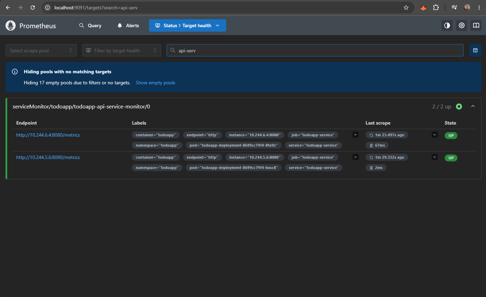
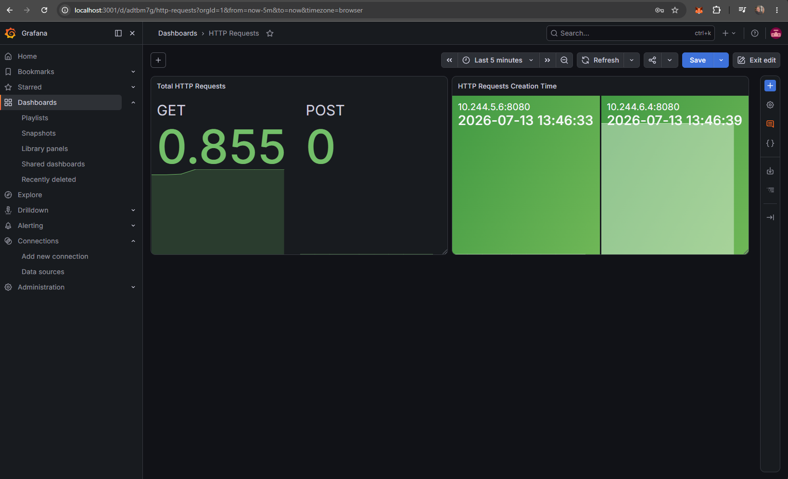

# Running the Infrastructure and the App

This guide covers spinning up the local `kind` cluster with the app, Prometheus, and Grafana, and verifying that monitoring is working.

## Prerequisites

- `docker`
- `kind`
- `kubectl`
- `helm`

## 1. Setup Kubernetes cluster

Run the bootstrap script from the repo root:

```bash
./bootstrap.sh
```

This script will:
- Create the `kind` cluster (`cluster.yml`)
- Install the NGINX Ingress Controller
- Install `kube-prometheus-stack` (Prometheus, Grafana, Alertmanager) into the `monitoring` namespace
- Deploy the `todoapp` chart

Wait for the script to finish — it blocks on `--wait` for each Helm install, so once it exits, all pods should be ready.

Verify everything is up:

```bash
kubectl get pods -A
kubectl get svc -A
```

The app itself is served through the Ingress on **port 80**.

## 2. Access Prometheus

Port-forward the Prometheus service:

```bash
kubectl port-forward -n monitoring svc/kube-prometheus-stack-prometheus 9091:9090
```

Open [http://localhost:9090](http://localhost:9091).

Go to **Status → Target health** and confirm the `todoapp` ServiceMonitor target shows as **UP**.



## 3. Access Grafana

Port-forward the Grafana service:

```bash
kubectl port-forward -n monitoring svc/kube-prometheus-stack-grafana 3001:80
```

Open [http://localhost:3001](http://localhost:3001).

**Login:**
- Username: `admin`
- Password:
  ```bash
  kubectl get secret -n monitoring kube-prometheus-stack-grafana \
    -o jsonpath="{.data.admin-password}" | base64 -d
  ```



## Teardown

```bash
kind delete cluster
```