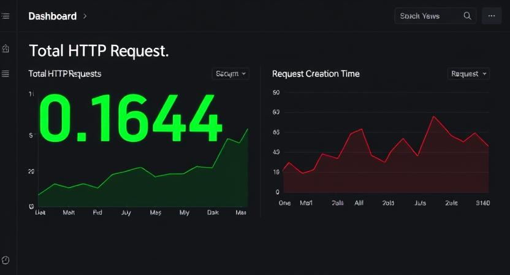

# Kubernetes Observability: Prometheus & Grafana

## 📖 Project Overview
This project demonstrates the implementation of a comprehensive, Kubernetes-native observability stack. It covers the full monitoring lifecycle: from instrumenting a web application to expose custom metrics, to deploying and configuring the `kube-prometheus-stack` via Helm, and finally visualizing the data through custom Grafana dashboards.

## 🛠 Tech Stack & Tools
* **Monitoring & Observability:** Prometheus, Grafana, PromQL
* **Container Orchestration:** Kubernetes (kind)
* **Package Management:** Helm
* **Application Instrumentation:** Python (Django), `prometheus_client`

## ⚙️ Implementation Details
The monitoring setup was engineered following K8s best practices:
1. **Application Instrumentation:** Integrated the `prometheus_client` library into the application to expose a custom `/metrics` endpoint. Configured the app to track and expose HTTP GET and POST request counts in a Prometheus-compatible format.
2. **Stack Deployment:** Provisioned a local Kubernetes cluster and deployed the industry-standard `kube-prometheus-stack` using Helm, ensuring proper admission webhook configurations.
3. **Dynamic Scraping (ServiceMonitor):** Configured a `ServiceMonitor` Custom Resource Definition (CRD) within the application's Helm chart. This enables Prometheus to automatically discover and scrape the application's metrics without manual target configuration.
4. **Data Visualization:** Built a custom Grafana dashboard utilizing PromQL to visualize critical traffic metrics, including the total HTTP request rate (`sum(rate(...))`) broken down by HTTP method, and application uptime/creation metrics.

## 📸 Implementation Evidence
Below is a snapshot of the custom Grafana dashboard successfully pulling, analyzing, and visualizing the instrumented application metrics from the Kubernetes cluster:

<b>Grafana Custom Dashboard</b> (Click to expand)

 

## 📝 Code Review & Approval
This observability implementation has been rigorously reviewed by a Senior DevOps Engineer. The review ensured correct Helm chart templating, accurate Prometheus scraping configuration, and valid PromQL query usage. 

You can view the full discussion, implementation details, and final approval in the **[Pull Request #49](https://github.com/mate-academy/devops_todolist_monitoring_task/pull/49)**.
